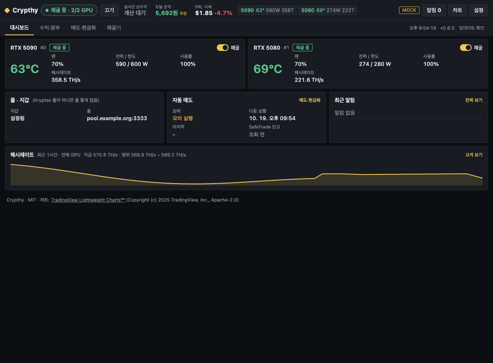
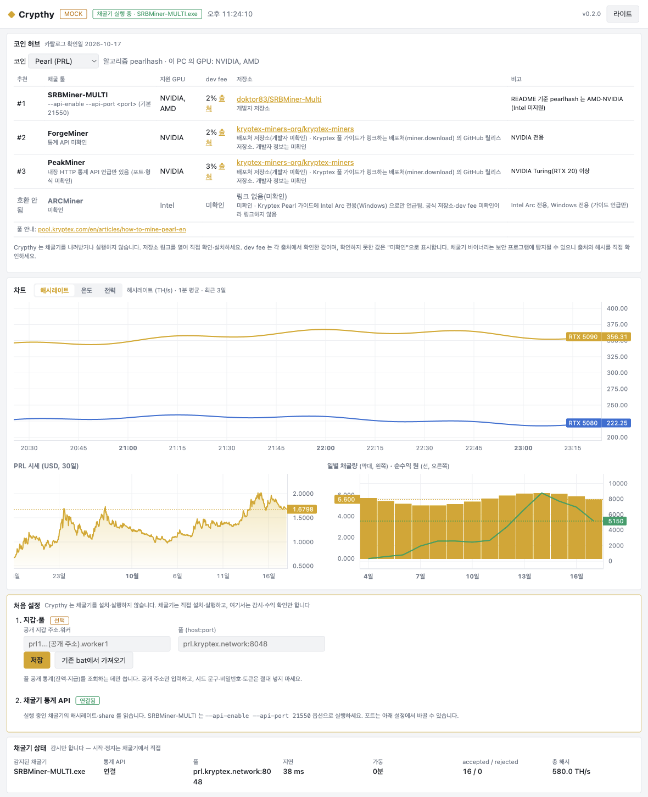

[English](README.md) | **한국어** | [简体中文](README.zh-CN.md)

<p align="center"></p>

# Crypthy

NVIDIA GPU가 달린 **Windows / Ubuntu(Linux)** PC를 위한 코인 채굴 허브, GPU/PC 관리, 채굴 수익 확인 앱입니다.

[](https://github.com/Ruderud/crypthy/actions/workflows/ci.yml)
[](https://github.com/Ruderud/crypthy/releases)
[](LICENSE)
[](#download-and-install)



> **먼저 알아 둘 것**
> - **Crypthy는 채굴기를 설치하거나 실행하지 않습니다.** 호환되는 채굴 툴을 공식 저장소 링크와 함께 추천할 뿐이고, 채굴기는 사용자가 직접 설치하고 실행합니다.
> - **기본 지갑과 앱 수수료(dev fee)가 없습니다.** 지갑 주소는 풀 공개 통계 조회에만 씁니다.
> - **위험할 때는 정지만 합니다.** 팬 정지나 과열이 생기면 실행 중인 알려진 채굴기를 정지하고 다시 시작하지 않습니다. 이 동작은 끌 수 있습니다.
> - **빌드에 코드 서명이 없습니다.** 릴리스마다 올라오는 `SHA256SUMS.txt`로 내려받은 파일을 확인하세요.
> - 채굴은 전기 요금이 들고 GPU에 부담을 주며 손실이 날 수 있습니다. 안전 감시는 보조 수단일 뿐 보장이 아닙니다.
>
> 자세한 내용: [안전과 개인정보](#safety-and-privacy)

## 기능

### 코인 허브

- 코인을 고르면 알고리즘, 이 PC에서 감지한 GPU 벤더(NVIDIA, AMD, Intel), 호환 채굴 툴의 추천 순위를 보여 줍니다. 툴별로 공식 저장소 링크, 지원 GPU, dev fee, 비고가 함께 표시됩니다.
- 목록은 큐레이션 파일 [`catalog/catalog.json`](catalog/catalog.json)에서 관리합니다. 값마다 출처 URL과 확인일을 남기고, 확인하지 못한 값은 **미확인**으로 표시하며, 공식 저장소를 확인하지 못한 툴은 링크하지 않습니다.
- 순위: 이 PC의 GPU와 호환 → dev fee 확인됨 → 출처 불일치 → 미확인 → 확인된 dev fee가 낮은 툴 순입니다.

2026-10-17 기준 카탈로그:

| 코인 | 툴 | GPU | dev fee | 저장소 |
|---|---|---|---|---|
| Pearl (PRL, pearlhash) | SRBMiner-MULTI | NVIDIA, AMD | 2% | [doktor83/SRBMiner-Multi](https://github.com/doktor83/SRBMiner-Multi) |
| | ForgeMiner | NVIDIA | 2% | [kryptex-miners-org/kryptex-miners](https://github.com/kryptex-miners-org/kryptex-miners) (배포처, 개발자 미확인) |
| | PeakMiner | NVIDIA | 3% | 같은 배포처 저장소 |
| | ARCMiner | Intel Arc | 미확인 | 링크 없음(미확인) |
| Quantus (QTC, Poseidon2/QPoW) | ForgeMiner | NVIDIA | 2% | 배포처 저장소 |
| | PeakMiner | NVIDIA | 2% | 배포처 저장소 |
| | SRBMiner-MULTI | NVIDIA, AMD, Intel | 출처 불일치 (2.00% / 2.5%) | doktor83/SRBMiner-Multi |
| | quantus-miner (공식) | wgpu·CUDA | 미확인 | [Quantus-Network/quantus-miner](https://github.com/Quantus-Network/quantus-miner) |

### PC 관리

- **GPU 대시보드**: `nvidia-smi`를 2초마다 읽어 온도, 팬, 전력/한도, 사용률을 보여 줍니다. GPU는 PCI bus id로 식별합니다.
- **안전 감시**: 팬 정지, 과열, 온도 값 소실이 생기면 알려진 채굴기를 정지합니다. [안전 감시](#safety-watch)를 참고하세요.
- **전력 제한**: GPU별로 W를 정하고, 처음 한 번만 관리자 승인을 받으면 이후 자동으로 다시 적용됩니다(Windows 예약 작업 / Linux systemd 서비스). 앱 본체는 일반 사용자 권한으로 실행됩니다.
- **트레이 앱**: 로그인 시 실행(선택), 읽기 전용 **로컬 상태 API**, GitHub Releases를 통한 **자동 업데이트**를 지원합니다.

### 차트

[TradingView Lightweight Charts™](https://www.tradingview.com/lightweight-charts/)(Apache-2.0)로 그립니다.
- GPU별 해시레이트, 온도, 전력 (1분 평균, 최근 3일, GPU당 최대 4,320점, 최대 16개 GPU)
- 코인 30일 시세 (CoinGecko, USD)
- 일별 채굴량(막대)과 원화 순수익(선): 그날 종가 또는 현재 시세로 환산하고 전기료를 뺍니다.

### 채굴량·수익

- **실시간 추정(원/h)**: 실측 해시레이트 × 풀 통계 기대 채굴량 × 시세 − 실측 GPU 전력비입니다. 해시레이트는 채굴기 통계 API에서 가져오고(SRBMiner-MULTI는 `--api-enable --api-port 21550`), 풀 통계는 Kryptex에서 받으며 지갑을 입력하지 않아도 조회합니다. 오늘·이번 달 추정치는 같은 시간 동안 채굴량과 전력량을 함께 쌓아 계산합니다.
- **풀 확정**: 풀이 공개하는 누적값(미지급 잔액 + 지급)을 기준으로 합니다. **풀 누적 채굴량**은 앱을 켜기 전에 채굴한 몫까지 포함합니다. **확정 순수익**은 풀 누적이 늘어난 만큼의 채굴량과 그 증가가 일어나기까지 쓴 전력량을 **같은 구간**으로 짝지어 계산하며, 짝지은 구간이 3시간이 되기 전에는 "집계 중"으로 표시합니다. 그래서 앱을 켠 직후나 자정 직후에 전력비만 음수로 보이는 일이 없습니다.
- **시세**: CoinGecko에서 가져와 설정의 환율로 원화로 바꿉니다. 조회에 실패하면 마지막 정상 시세를 시각과 함께 씁니다(30분이 지나면 "지난 시세"로 표시). 한 번도 받지 못했다면 순수익을 계산하지 않고 "시세 없음"으로 표시합니다.
- **채굴 vs 대여**(정보 표시만): GPU별 채굴 순수익과 대여 순수익(표시가 × 호스트 몫 − 임대 중 전력비)을 비교합니다. 대여가 더 유리해지거나, GPU별 가격 기준을 넘거나, 코인 시세가 정해 둔 비율만큼 떨어지면 재검토 알림을 보냅니다.
- **Vast 대여 시세**: 로그인 없이 공개 검색으로 같은 모델의 1장짜리 매물을 30분마다 조회합니다. 기본적으로 **verified 매물만** 씁니다(미인증·인증 해제 매물은 최저가 쪽에 몰립니다. 2026-10-18 RTX 5090 온디맨드 매물을 모두 넣으면 $0.699, verified만 넣으면 $0.869였습니다). 온디맨드 또는 중단 가능 매물을 고를 수 있고, 국가 필터는 선택이며, DLPerf 중앙값의 80%에 못 미치는 매물은 뺍니다. 중앙값, 하위 25%, 표본 수, 조회 시각을 표시하며, 표본이 5개 미만이면 "데이터 부족"으로 표시합니다. GPU별 수동값을 넣으면 수동값이 우선합니다.

### 누적 손익(PnL)

- 풀 누적 증가, 지급, 시세, 10분 단위 전력 구간을 로컬 이벤트 로그(`pnl/events.jsonl`)에 한 줄씩 추가합니다. 한 줄이 한 이벤트이고, 깨진 줄은 건너뛰며, 5MB가 넘으면 한 번 회전합니다. 일별 집계는 `pnl/daily.json`에 기간 제한 없이 보관하고, 아래 수치는 모두 이 집계를 기준으로 합니다.
- **계산 정의**: 매출 = 채굴량 × 채굴 시점 시세, 전력비 = 실측 GPU 전력량 × 그때의 전기 단가, 실현 손익 = 매도 기록 − 수수료, 미실현 손익 = 보유량(채굴 − 매도) × 현재가, **총 PnL = 실현 + 미실현 − 전력비**입니다.
- 오늘·7일·30일·전체 집계와 일별 순익 막대, 누적 PnL 선을 보여 줍니다. 시세가 없을 때 채굴된 몫은 다음 시세로 평가하고 "추정"으로 표시합니다. 현재가가 없으면 미실현·총 PnL을 0원이 아니라 "시세 없음"으로 표시합니다.
- **소급 적용(1회)**: 기록을 시작하기 전에 채굴한 몫(기록 시작 시점의 풀 누적치)을 입력한 채굴 시작 시각부터 시간 비율로 나누고, 전력비는 입력한 W로 추정합니다. 소급한 날은 "추정"으로 표시합니다.
- **매도 기록**(선택): 수량, 매도 대금, 수수료, 거래소, 메모를 입력하며 로컬에만 저장합니다. 매도 기록이 없으면 전부 미실현으로 계산합니다.
- 일별 집계와 이벤트를 **CSV로 내보낼** 수 있고, 로그 폴더를 바로 열 수 있습니다.

### 테마

거래소 대시보드 느낌의 다크 테마가 기본입니다(노란 강조색, 숫자 등폭 표시, 상승은 초록·하락은 빨강). 라이트와 시스템 테마도 지원합니다. 특정 거래소의 로고·이름·아이콘은 쓰지 않습니다.

## 스크린샷


<details><summary>라이트 테마</summary>



</details>

스크린샷은 모의 모드(`npm run start:mock`)의 합성 데이터입니다.

<a id="download-and-install"></a>

## 다운로드와 설치

[Releases](https://github.com/Ruderud/crypthy/releases)에서 내려받습니다. `nvidia-smi`가 포함된 NVIDIA 드라이버가 필요합니다.

| 플랫폼 | 파일 | 자동 업데이트 |
|---|---|---|
| Windows 10/11 x64 | `Crypthy-<version>-setup-x64.exe` (설치형) | 예 |
| Windows 10/11 x64 | `Crypthy-<version>-win-x64.zip` (무설치) | 아니요 |
| Linux x64 | `Crypthy-<version>-linux-x86_64.AppImage` | 예 |
| Linux x64 (Debian/Ubuntu) | `Crypthy-<version>-linux-amd64.deb` | 아니요 |

### 내려받은 파일 확인

빌드에 코드 서명이 없습니다. 같은 릴리스의 `SHA256SUMS.txt`와 해시를 비교하세요.

```powershell
Get-FileHash .\Crypthy-0.2.0-setup-x64.exe -Algorithm SHA256
```

```bash
sha256sum -c SHA256SUMS.txt --ignore-missing
```

### Windows

1. 설치 파일을 실행합니다. 서명되지 않은 앱이라 SmartScreen 경고가 뜰 수 있습니다. 해시를 확인했다면 **추가 정보 → 실행**을 누르고 MIT 라이선스에 동의합니다.
2. 설치는 사용자 단위라 관리자 권한이 필요 없습니다. 기본 경로는 `%LOCALAPPDATA%\Programs\Crypthy`입니다.

### Linux (Ubuntu) — v0.3.0, 실기 미검증

- AppImage (Ubuntu 22.04 이상에서는 `libfuse2`가 필요할 수 있습니다):
  ```bash
  chmod +x Crypthy-*.AppImage && ./Crypthy-*.AppImage
  ```
- deb:
  ```bash
  sudo apt install ./Crypthy-*.deb
  ```
- 트레이 아이콘은 Ubuntu의 AppIndicator를 씁니다. 다른 데스크톱 환경에서는 AppIndicator 확장이 필요할 수 있습니다. "로그인 시 앱 실행"을 켜면 `~/.config/autostart/crypthy.desktop`을 만듭니다.

## 빠른 시작

1. **코인 허브**에서 코인을 고르고, 추천 채굴 툴의 저장소로 가서 채굴기를 **직접** 설치합니다. 출처, 해시, dev fee는 저장소에서 다시 확인하세요. 보안 프로그램이 채굴기를 차단하면 예외를 둘지는 사용자가 판단합니다.
2. 채굴기를 통계 API를 켠 상태로 실행합니다. SRBMiner-MULTI라면 `--api-enable --api-port 21550`을 붙이고, 다른 포트를 쓴다면 **설정 → 채굴기 API 포트**도 같은 값으로 맞춥니다.
3. (선택) **처음 설정 → 지갑·풀**에 공개 지갑 주소에 `.워커명`을 붙여 입력하고, 풀을 `host:port` 형식으로 입력하면 풀 확정 채굴량을 볼 수 있습니다. **기존 bat에서 가져오기**는 채굴기 `.bat`에서 `--wallet`과 `--pool` 값을 읽어 옵니다.

앱 화면은 현재 한국어만 지원합니다.

### 0.1.x에서 업데이트

- 지갑, 풀, 전력 제한, 안전 기준값, 수익 설정은 유지됩니다. 0.1.x의 채굴기 실행 관련 설정(채굴기 폴더, GPU 선택·매핑, 동의 기록)은 버려집니다.
- "안전 제외"였던 GPU는 **안전 보류**로 이어집니다.
- 0.2.0 이후는 채굴기를 시작하지 않습니다. 0.1.x가 시작한 채굴기는 계속 돌지만, 이후 시작·재시작은 직접 해야 합니다.
- 0.3.1 이하에서 업데이트하면 장부를 변환합니다. 풀 누적 기준점은 유지하고, 예전 일별 값은 채굴량으로만 표시합니다(순수익 계산에서는 제외).

## 설정

### 설정 항목

| 설정 | 기본값 | 비고 |
|---|---|---|
| 코인 | Pearl | 허브, 시세, 풀 통계에 쓰는 카탈로그 코인 |
| 지갑 / 풀 | 비어 있음 | 공개 주소 `.worker`와 `host:port`. 풀 공개 통계에만 사용 |
| 채굴기 통계 API / 포트 | SRBMiner-MULTI / 21550 | `none`이면 끕니다 |
| 위험 조건에서 채굴기 정지 | 켜짐 | 끄면 알림만 보냅니다 |
| 로그인 시 실행 | 꺼짐 | Windows 로그인 항목 / Linux XDG autostart |
| 업데이트 확인 주기 | 60분 | 30~1440분 |
| 팬 정지 기준 전력 / 시간 | 100 W / 10초 | 안전 감시 |
| 온도 경고 / 정지 | 80°C / 85°C | 안전 감시 |
| 전기 요금 / 환율 | 350 KRW/kWh / 1340 KRW/$ | 수익 |
| 대여 호스트 몫 / 임대 중 전력 | 0.75 / 250 W | 채굴 vs 대여 |
| 시세 하락 알림 / 기준가 | 30% / 처음 본 시세 | 재검토 알림 |
| Vast verified만 / 매물 유형 / 지역 | 켜짐 / 온디맨드 / 전체 | 대여 시세 필터 |

### 전력 제한 — Windows (UAC 1회)

1. **GPU 설정 · 전력 제한** 표에 GPU별 W를 입력합니다(nvidia-smi가 알려 주는 범위 안이어야 하며, 빈칸이면 건드리지 않습니다).
2. **전력 제한 예약 작업 등록 (UAC 1회)** 을 누르고 승인합니다. 관리자 권한으로 실행되는 `resources\ps\register-power-task.ps1`이 다음을 수행합니다.
   - `C:\ProgramData\Crypthy\` 폴더를 권한을 붙인 채로 한 번에 새로 만듭니다(소유자 Administrators, 상속 차단, Users는 읽기·실행만). 이미 junction/symlink가 있으면 스크립트를 중단합니다.
   - 적용 스크립트를 그 폴더에 복사하고 예약 작업 `Crypthy-PowerLimit`을 등록합니다(현재 사용자, 가장 높은 권한, 로그온 30초 뒤).
3. 값을 바꾼 뒤에는 **전력 제한 지금 적용**을 누릅니다. 앱은 `%APPDATA%\Crypthy\power-limits.json`에 PCI bus id와 W만 쓰고 `schtasks /run`을 실행합니다. 로그는 `C:\ProgramData\Crypthy\power-limit.log`입니다.

예약 작업은 JSON을 데이터로만 읽고, PCI bus id와 100~1000 정수만 `C:\Windows\System32\nvidia-smi.exe -i <bus id> -pl <W>`에 넘깁니다. 신뢰할 수 있는 설치본에서만 등록하세요(원본 스크립트가 사용자 쓰기 가능한 설치 폴더에 있습니다).

```powershell
schtasks /delete /tn Crypthy-PowerLimit /f
Remove-Item -Recurse C:\ProgramData\Crypthy
```

### 전력 제한 — Linux (관리자 인증 1회)

1. W를 입력하고 **전력 제한 서비스 설치 (관리자 인증 1회)** 를 눌러 `pkexec` 인증 창에서 승인합니다. 동봉된 `resources/linux/install-power-service.sh`가 root로 다음을 수행합니다.
   - `/usr/local/lib/crypthy/apply_power_limits.py`를 root 소유, 0755 권한으로 설치합니다.
   - oneshot 서비스 `crypthy-power-limit.service`를 만듭니다(부팅할 때 적용, `ProtectSystem=strict` 등 보호 옵션 사용).
   - `/etc/polkit-1/rules.d/50-crypthy-power-limit.rules`를 만들어 **이 사용자만** **이 서비스를 start**하는 것만 허용합니다.
2. **전력 제한 지금 적용**은 `~/.config/Crypthy/power-limits.json`(PCI bus id와 W만)을 쓰고 `systemctl start crypthy-power-limit.service`를 실행합니다. polkit JS 규칙을 지원하지 않는 환경(예: Ubuntu 22.04의 polkit 0.105)에서는 적용할 때마다 `pkexec` 인증 창이 뜹니다.
3. 로그는 `/var/lib/crypthy/power-limit.log`입니다. 입력 규칙은 Windows와 같습니다. 데이터로만 읽고, PCI bus id 형식과 100~1000 정수만 받으며, 최대 16개까지 처리하고, nvidia-smi는 고정 경로만 쓰고, 셸을 거치지 않으며, JSON이 아닌 내용은 로그에 남기지 않습니다.

```bash
sudo systemctl disable --now crypthy-power-limit.service
sudo rm -f /etc/systemd/system/crypthy-power-limit.service /etc/polkit-1/rules.d/50-crypthy-power-limit.rules
sudo rm -rf /usr/local/lib/crypthy /var/lib/crypthy
sudo systemctl daemon-reload
```

### 자동 업데이트

- Windows 설치형과 Linux AppImage에서만 동작합니다. 앱 창이 뜬 뒤 몇 초 안에 한 번 확인하고 이후 1시간마다 확인합니다(설정에서 30분~24시간). 앱 상단과 트레이 메뉴에 **업데이트 확인**이 있습니다.
- 새 버전이 있으면 OS 알림(트레이에만 있어도 옴)과 함께 헤더 아래에 고정된 배너에 릴리스 노트가 뜹니다. 알림, **업데이트 확인**, 트레이의 새 버전 항목을 누르면 **받기 / 나중에** 대화상자가 뜨고, 다 받은 뒤에는 **지금 재시작해 설치 / 나중에** 를 고릅니다. 배너에도 같은 버튼이 있습니다.
- **나중에**는 같은 안내를 다음 정기 확인 때까지 숨깁니다. 수동으로 확인하면 다시 보입니다.
- 설치는 사용자가 누를 때만 이뤄집니다. Crypthy는 채굴기를 관리하지 않으므로 재시작해도 채굴은 계속되고, 안전 감시만 잠시 멈춥니다.
- 받은 파일은 `latest.yml` / `latest-linux.yml`의 sha512로 확인합니다. 코드 서명이 없어 서명 검증(`verifyUpdateCodeSignature`)은 끕니다. 따라서 이 검증은 받은 파일이 GitHub Releases에 올라간 파일과 같다는 것까지만 보장합니다.
- 업데이트가 실패하면 알림만 남기고 안전 감시에는 영향을 주지 않습니다. `CRYPTHY_MOCK=1 CRYPTHY_MOCK_UPDATE=1`로 안내 흐름을 확인할 수 있습니다.

### 로컬 상태 API

`GET http://127.0.0.1:47321/v1/status`

```json
{
  "ts": 1792238907285,
  "miner": { "running": true, "mode": "external", "pool": "prl.kryptex.network:8048", "uptime_s": 14, "accepted": 8, "rejected": 0 },
  "gpus": [
    { "index": 0, "name": "NVIDIA GeForce RTX 5090", "temp_c": 63, "fan_pct": 70, "power_w": 581, "power_limit_w": 600, "util_pct": 100, "hashrate": 352793011501620 }
  ],
  "alerts": [ { "ts": 1792238891651, "level": "critical", "code": "miner_killed", "gpu": null, "message": "..." } ]
}
```

- `127.0.0.1`에만 바인딩합니다. Host 헤더가 `127.0.0.1:47321` / `localhost:47321`이 아니면 403(DNS rebinding 차단), GET이 아니면 405, 다른 경로는 404를 돌려줍니다.
- 응답은 gpus 최대 8개, alerts 최대 20개(최신순), 문자열은 120자까지입니다. 지갑·설정은 넣지 않습니다.
- `mode`: `external`(채굴기 실행 중. Crypthy는 채굴기를 실행하지 않습니다) 또는 `null`. `hashrate`는 H/s입니다. alert `gpu`는 PCI bus id입니다.
- alert code — 안전: `fan_stopped`, `temp_stop`, `temp_warn`, `telemetry_lost`, `miner_killed`, `miner_killed_again`, `kill_failed`, `safety_hold_running`, `hold_cleared`; 재검토: `review_rental_price`, `review_rental_better`, `review_prl`; 업데이트: `update_available`, `update_ready`, `update_error`; 기타: `status_api`.
- 응답에는 반올림한 집계값만 담은 `pnl` 객체도 들어갑니다(`mined_coin`, `holdings_coin`, `revenue_krw`, `energy_cost_krw`, `realized_krw`, `unrealized_krw`, `total_pnl_krw`, `estimated`). 원시 로그는 노출하지 않습니다.

### 파일 위치

| 파일 | 경로 |
|---|---|
| 설정 | Windows `%APPDATA%\Crypthy\settings.json` · Linux `~/.config/Crypthy/settings.json` |
| 안전 보류 | `%APPDATA%\Crypthy\runtime.json` |
| 일/월 장부 | `%APPDATA%\Crypthy\ledger.json` |
| 차트 기록(최근 3일) | `%APPDATA%\Crypthy\history.json` |
| 전력 제한 값 | `%APPDATA%\Crypthy\power-limits.json` |
| 전력 제한 스크립트·로그 | `C:\ProgramData\Crypthy\` |
| PnL 이벤트 로그(5MB에서 회전) | `%APPDATA%\Crypthy\pnl\events.jsonl` |
| PnL 일별 집계(기간 제한 없음) | `%APPDATA%\Crypthy\pnl\daily.json` |

<a id="safety-and-privacy"></a>

## 안전과 개인정보

<a id="safety-watch"></a>

### 안전 감시

| 조건 | 동작 |
|---|---|
| 전력 > 100 W이고 팬 0%가 10초 이상 | 해당 GPU **안전 보류** + 실행 중인 알려진 채굴기 정지 + critical 알림 |
| 온도 ≥ 85°C | 같음 |
| 채굴 중인데 온도 값이 5회(약 10초) 연속 없음 | 같음 |
| 온도 ≥ 80°C | 경고(77°C 아래로 내려가면 다시 감시) |

- **정지 대상**
  - Windows: 카탈로그에서 실행 파일 이름이 확인된 채굴기(`SRBMiner-MULTI.exe`, `peakminer.exe`, `forge.exe`, `arc-miner.exe`)를 `taskkill`로 정지하고, tasklist로 실제로 꺼졌는지 확인합니다.
  - Linux: 릴리스 아카이브에서 이름을 확인한 `SRBMiner-MULTI`, `peakminer`, `forge`를 `/proc`에서 찾아 SIGTERM을 보내고, 3초 뒤에도 살아 있으면 SIGKILL을 보냅니다. 명령줄에 풀·지갑·알고리즘 인자가 있는 프로세스만 대상으로 삼으므로, 같은 이름의 다른 도구(예: Foundry의 `forge`)는 건드리지 않습니다.
  - 실행 파일 이름이 미확인인 툴(예: quantus-miner)은 정지할 수 없어 알림만 보냅니다.
- **컨테이너는 절대 정지하지 않음(Linux)** — Vast.ai 고객 워크로드 같은 컨테이너를 보호합니다. 다음 중 하나라도 해당하면 건너뛰며, 판별할 수 없을 때도 건너뜁니다.
  - cgroup 경로에 docker / containerd / kubepods / podman / lxc 등이 있음
  - 앱과 다른 PID 네임스페이스에 있거나, 네임스페이스를 읽을 수 없음
  - 조상 프로세스에 containerd-shim / dockerd / runc / conmon 등이 있음
- 정지는 GPU 단위가 아니라 채굴기 단위이며, 앱은 채굴기를 다시 시작하지 않습니다.
- **보류는 유지됩니다.** 앱 재시작과 재부팅 후에도 남고, 보류 중에 채굴기가 다시 실행되면 15초 간격으로 다시 정지합니다. 원인을 해결한 뒤 GPU 카드의 **보류 해제**를 누르면 풀립니다. 채굴기가 없을 때(예: 게임 중 과열)도 보류가 걸립니다.
- nvidia-smi가 실패해도 채굴기 API의 장치 값(PCI bus 기준)으로 감시를 이어 갑니다. tasklist가 실패하면 알려진 이름 전부에 정지를 시도하고, 확인하지 못하면 critical 알림을 보냅니다. 실행 파일 이름을 모르는 채굴기가 API로만 감지되면 정지할 수 없다고 알립니다.
- 실행 파일 이름이 정확히 같은 다른 프로그램도 정지될 수 있습니다(예: 다른 `forge.exe`).
- **설정 → 위험 조건에서 실행 중인 채굴기 자동 정지**를 끄면 critical 알림만 반복합니다. 관리자 권한으로 실행된 채굴기는 비관리자 앱이 끌 수 없으니 작업 관리자에서 직접 종료하세요.
- nvidia-smi `fan.speed`는 드라이버가 지시한 목표 속도이지 실제 RPM이 아닙니다. 팬이 물리적으로 막혀도 0%로 보이지 않을 수 있어서, 최종 안전장치는 온도 규칙입니다.

### 개인정보와 네트워크 요청

- 텔레메트리, 계정, 원격 제어, 쓰기 API가 없습니다.
- 지갑 시드·비밀번호·토큰을 요구하거나 저장하지 않으며, Windows Defender·방화벽 같은 보안 설정을 바꾸지 않습니다.
- 채굴기를 내려받거나 설치·실행·재시작하지 않고, 채굴기 실행 인자도 만들지 않습니다.
- 외부로 보내는 요청은 공개 조회뿐입니다.
  - CoinGecko 시세
  - Kryptex 풀 통계·공개 지갑 잔액
  - Vast.ai 공개 오퍼
  - GitHub Releases 업데이트 확인

### 서명되지 않은 빌드

빌드에 코드 서명이 없어 Windows SmartScreen 경고가 뜰 수 있습니다. 모든 릴리스에 `SHA256SUMS.txt`가 포함되고, 자동 업데이트는 릴리스 메타데이터의 sha512를 확인합니다. 보안 문제는 [SECURITY.md](SECURITY.md)의 안내에 따라 신고해 주세요.

## FAQ

**Crypthy가 채굴하거나 수수료를 받나요?**
아니요. 채굴기를 실행하지 않고 dev fee도 없습니다. 사용자가 설치하는 채굴기에는 자체 dev fee가 있을 수 있으며, 코인 허브에 표시됩니다.

**확정 수익이 왜 "집계 중"으로 나오나요?**
풀 잔액은 띄엄띄엄 늘어납니다. 최소 3시간 분량의 채굴량을 같은 구간의 전력량과 짝지은 뒤에 확정 순수익을 보여 주며, 그 전에는 실시간 추정을 참고하세요.

**안전 정지는 뜨거운 GPU만 멈추나요?**
아니요. Crypthy는 채굴기 프로세스 전체를 정지하므로 그 채굴기가 쓰던 GPU가 모두 멈추고, 다시 시작하지 않습니다.

**Linux에서 Vast.ai 대여가 정지되나요?**
아니요. 컨테이너(docker/containerd/podman/lxc, 다른 PID 네임스페이스, 컨테이너 런타임 하위)의 프로세스는 채굴기로 보지 않습니다.

**백신이 채굴기를 악성으로 탐지하는 이유가 뭔가요?**
채굴 소프트웨어는 흔히 탐지됩니다. Crypthy는 보안 설정을 바꾸지 않으니, 출처와 해시를 확인한 뒤 직접 판단하세요.

**앱 화면이 왜 한국어인가요?**
지금은 화면이 한국어만 지원됩니다. 번역 기여를 환영합니다. [CONTRIBUTING.md](CONTRIBUTING.md)를 참고하세요.

## 로드맵

[docs/ROADMAP.md](docs/ROADMAP.md)와 [CHANGELOG](CHANGELOG.md)를 참고하세요.

## 기여

이슈와 풀 리퀘스트를 환영합니다. 먼저 [CONTRIBUTING.md](CONTRIBUTING.md)와 [행동 강령](CODE_OF_CONDUCT.md)을 읽어 주세요.

```bash
npm install
npm test             # unit tests (vitest)
npm run typecheck
npm run check:readme # README.md / README.ko.md / README.zh-CN.md structure in sync
npm run start:mock   # UI with mock hardware (works on macOS/Linux)
npm run dist:win     # Windows x64 NSIS + zip + latest.yml + SHA256SUMS (no upload)
npm run dist:linux   # Linux x64 AppImage + deb + latest-linux.yml (builds on macOS too)
```

- 모의 모드 옵션: `CRYPTHY_MOCK_FANSTOP=<nvidia-smi index>`(30초 뒤 팬이 0%가 됨), `CRYPTHY_MOCK_KILLFAIL=1`, `CRYPTHY_MOCK_IDLE=1`, `CRYPTHY_MOCK_UPDATE=1`(가짜 업데이트 v0.9.9).
- 카탈로그를 수정할 때는 출처 URL과 확인일이 필요합니다. 테스트가 확인된 dev fee의 출처, GitHub 전용 저장소 링크, 미확인 툴의 링크 없음을 강제합니다.
- 새 채굴기 통계 API는 `src/main/minerApi.ts`의 `MINER_APIS`에 어댑터로 추가합니다.
- `README.md`, `README.ko.md`, `README.zh-CN.md`는 같은 구조로 유지합니다. `npm run check:readme`가 CI에서 실행됩니다.
- 릴리스: `v*` 태그를 push하면 Windows와 Linux를 빌드해 설치 파일, `latest.yml`, `latest-linux.yml`, `SHA256SUMS.txt`를 올리고, [CHANGELOG](CHANGELOG.md)의 해당 버전 섹션을 릴리스 노트로 씁니다. 시크릿은 `GITHUB_TOKEN`만 씁니다.

## License

[MIT](LICENSE) © 2026 Ruderud

채굴 툴(SRBMiner-MULTI 등)은 이 저장소에 포함되지 않으며, 각자의 라이선스와 dev fee 정책을 따릅니다.

## 감사의 말

- [TradingView Lightweight Charts™](https://www.tradingview.com/lightweight-charts/) 5.2.1, Apache-2.0, Copyright (c) 2025 TradingView, Inc. 차트 안의 TradingView 로고 링크(`attributionLogo`)를 유지하고 앱 하단에 출처를 표기합니다. LICENSE와 NOTICE는 `resources/app.asar/dist/renderer/vendor/`에 함께 배포하며, 원문은 [`resources/third-party/lightweight-charts-NOTICE.txt`](resources/third-party/lightweight-charts-NOTICE.txt)에 있습니다.
- [Electron](https://www.electronjs.org/)(MIT), [electron-builder / electron-updater](https://www.electron.build/)(MIT).
- 공개 데이터: [CoinGecko](https://www.coingecko.com/), [Kryptex 풀](https://pool.kryptex.com/), [Vast.ai](https://vast.ai/).
